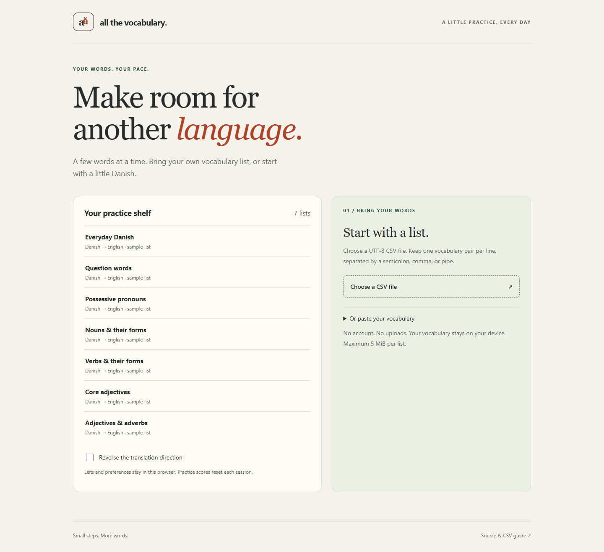
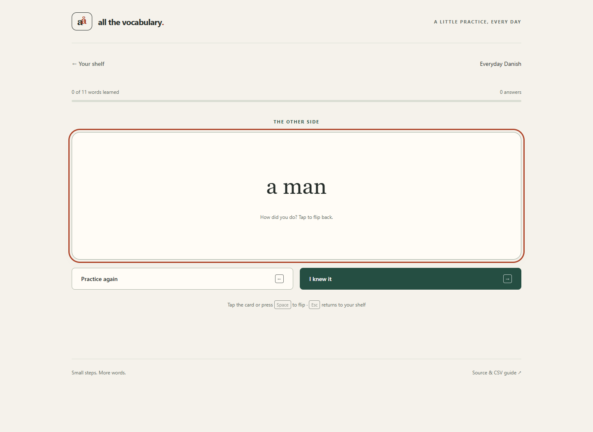

# All the Vocabulary

[](https://github.com/varnholt/vocabulary_trainer/actions/workflows/build.yml)
[](LICENSE)

A quiet place to practice vocabulary. Bring a CSV list, flip a card, and revisit the words that need a little more time. The training engine is C++, compiled to WebAssembly, with a responsive browser interface and an offline Android app.

**[Open the trainer](https://varnholt.github.io/vocabulary_trainer/)** · **[Android builds](https://github.com/varnholt/vocabulary_trainer/actions/workflows/build.yml)** · **[Releases](https://github.com/varnholt/vocabulary_trainer/releases)**

| Your vocabulary shelf | Card practice |
| --- | --- |
|  |  |

## Practice

1. Choose one of seven included Danish lists, import a UTF-8 CSV file, or paste your own pairs.
2. Optionally reverse the translation direction.
3. Select a list, think of the translation, and tap the card to reveal it.
4. Choose **I knew it** or **Practice again**. A session ends when every word has a positive score.

Correct answers add one to a word's score; incorrect answers subtract one. A word missed twice therefore needs three correct answers to leave the practice pool. When other words remain, the trainer avoids showing the same word twice in a row.

Custom lists and the reverse preference stay in browser storage on this device. Scores reset when a session starts. There are no accounts, analytics, external fonts, or vocabulary uploads. Clearing site data or uninstalling the Android app removes saved lists; keep your original CSV files. Storage quotas vary, and the app warns if a list cannot be saved.

### Controls

| Control                           | Action                                     |
| --------------------------------- | ------------------------------------------ |
| Tap/click the card or **Space**   | Flip the card                              |
| **Right arrow**                   | I knew it, after revealing the answer      |
| **Left arrow**                    | Practice again, after revealing the answer |
| **Escape** / **Your shelf**       | Leave the session                          |
| **Tab**, **Shift+Tab**, **Enter** | Navigate and activate controls             |

## Make a list

Save as UTF-8 text, with no header and one pair per record. Semicolon, comma, and pipe separators are detected from the first nonblank record. Use the same separator throughout. Maximum file size: **5 MiB**.

```csv
hej;hello
tak;thank you
en læge;a doctor
```

Quoted separators, doubled quotes, multiline fields, Windows line endings, and a UTF-8 BOM are supported:

```csv
"hello, friend","say ""hi"""
```

Lists can contain multiple forms of a word: all fields except the final translation appear together on the front of the card. Empty intermediate inflection fields are skipped; the first and last fields must contain text. Invalid records are reported with a line number, and the list is rejected without importing partial data.

```csv
en bil;bilen;biler;bilerne;a car
```

The original Danish lists are in [`testdata/`](testdata/).

## Android

Requires **Android 8.0+** and a current Android System WebView. The APK bundles the same interface, WebAssembly engine, and sample lists, so practice works offline. Import uses Android's document picker; no storage or internet permission is requested. Browser and Android libraries are separate and do not sync.

Download `vocabulary-Android-debug` from a successful [Actions run](https://github.com/varnholt/vocabulary_trainer/actions/workflows/build.yml), unzip it, and install the APK. These are sideloadable **debug builds**, not Play Store releases. Different CI runs can use different debug signing keys; reinstalling may require removing the previous app, which deletes its saved lists.

## Build and test

The new core has no library dependencies. Use **CMake 3.22+** and a **C++17** compiler:

```sh
cmake -S . -B build -DCMAKE_BUILD_TYPE=Release
cmake --build build --config Release --parallel
ctest --test-dir build -C Release --output-on-failure
```

For the browser, install and activate [Emscripten 6.0.1](https://emscripten.org/docs/getting_started/downloads.html), the version used in CI:

```sh
emcmake cmake -S . -B build-web -DCMAKE_BUILD_TYPE=Release -DBUILD_TESTING=OFF
cmake --build build-web --parallel
python -m http.server 8000 --directory build-web/web
```

Open `http://localhost:8000`. Serve through HTTP(S); opening `index.html` directly as a file will not load WebAssembly correctly. The output is a static site with no server-side code or special cross-origin headers. The hosted browser app requires a connection to load; the Android APK carries its assets offline.

Browser integration tests use the real compiled engine:

```sh
python -m pip install -r tests/requirements.txt
python -m playwright install chromium
python tests/test_web.py build-web/web
```

On Linux, use `python -m playwright install --with-deps chromium` if browser system dependencies are missing. `CHROMIUM_PATH` can point to an existing Chromium executable.

To build Android, first build `build-web` as above, then install **JDK 21**, **Android SDK platform 36**, and **build-tools 35.0.0**. Set `ANDROID_HOME` to your SDK directory:

```sh
cd android
./gradlew assembleDebug lintDebug
```

On Windows use `gradlew.bat`. The APK is written to `android/app/build/outputs/apk/debug/app-debug.apk`. The checked-in Gradle wrapper verifies its Gradle distribution checksum.

With a disposable Android emulator running, `python tests/test_android.py android/app/build/outputs/apk/debug/app-debug.apk` exercises the actual bundled WebAssembly, practice, system Back, pasted import, and storage. This check clears the trainer's app data before running. It uses the same Playwright package as the browser tests; no separate desktop Chromium download is needed for this check.

## Project layout

| Path                                           | Purpose                                                  |
| ---------------------------------------------- | -------------------------------------------------------- |
| [`src/`](src/)                                 | CSV parser, practice engine, WebAssembly bridge          |
| [`web/`](web/)                                 | Browser interface and local list storage                 |
| [`android/`](android/)                         | Offline Android WebView host                             |
| [`tests/`](tests/)                             | Native regression and browser workflow checks            |
| [`legacy/qt/`](legacy/qt/)                     | Original Qt desktop app, retained for reference          |
| [`docs/architecture.md`](docs/architecture.md) | Why a browser-native interface rather than an ImGui port |

CI tests the core on Windows, Linux, and macOS; builds and tests WebAssembly in Chromium; and builds, lints, and smoke-tests the Android APK in an emulator. Successful `main` builds deploy to GitHub Pages. Version tags publish downloadable web and Android packages.

See [contributing](CONTRIBUTING.md), [security](SECURITY.md), and the [changelog](CHANGELOG.md).

## License

Project code and vocabulary lists: [CC0 1.0 Universal](LICENSE). Android dependencies, the Gradle wrapper, and compiler runtime components retain their own licenses; see [third-party notices](THIRD_PARTY.md).
