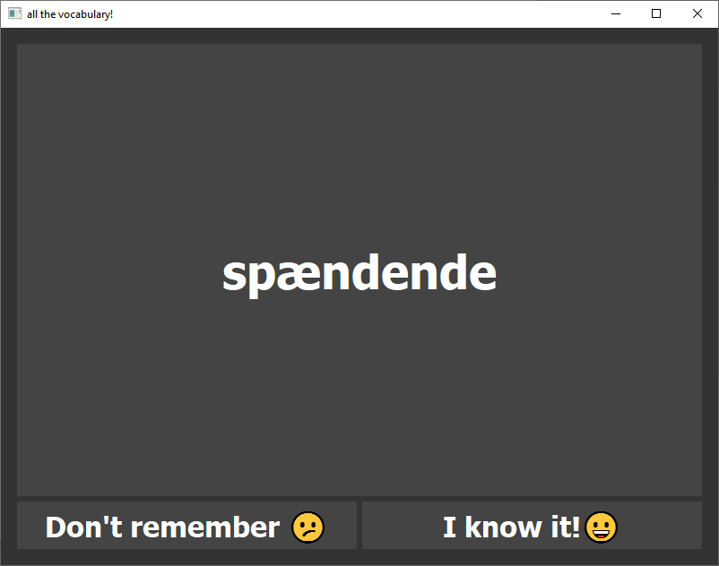
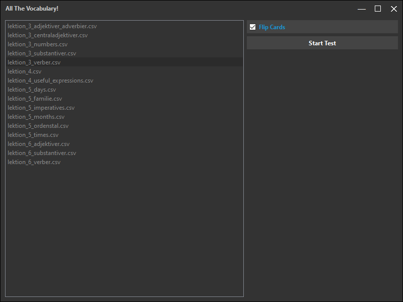

# Vocabulary Trainer

A small desktop flashcard app for vocabulary stored in plain CSV files. Flip a card, mark whether you knew the answer, and revisit words that still need practice.

| Vocabulary list and practice views | |
| --- | --- |
|  |  |

## Start a session

1. Put one or more `.csv` lists in the app's **working directory**. The [`testdata/`](testdata/) folder contains sample Danish lists.
2. Keep the [`css/`](css/) folder in that same directory so the interface can load its styles.
3. Launch the app, choose a list, optionally reverse the translation direction, and start.

Words you mark incorrectly stay in the practice pool; a session ends once every word has a positive score. Practice scores last for that session. The reverse-direction preference is saved in `settings.ini`.

## Make a vocabulary list

Use a simple text file with one pair per line and no header. The reader detects `;`, `,` or `|` as the separator. Use the same separator throughout a file. Quoted fields and separators inside a translation are not supported.

```csv
Hello;Hallo
English;Englisch
```

## Controls

| Key | Action |
| --- | --- |
| **Space** | Flip the current card |
| **Right arrow** | I knew this word |
| **Left arrow** | Practice this word again |
| **Escape** | Return to the list menu |

You can also click the word to flip it and use the on-screen answer buttons.

## Build from source

The project uses **C++11, Qt Widgets and qmake**. Use a **Qt 6** desktop kit: the mouse handling uses Qt 6 APIs.

Open [`vocabs.pro`](vocabs.pro) in Qt Creator, select a desktop kit and build. Set the run working directory to the repository root, then copy a sample CSV from `testdata/` into that root before launching. This keeps the styles and vocabulary files discoverable with a shadow build.

For a command-line build, run this from the repository root in a shell configured for your Qt kit:

```sh
mkdir build
cd build
qmake ../vocabs.pro
make
```

Use your kit's build tool in place of `make` where needed, such as `nmake` for MSVC. Launch the resulting executable with the repository root as its working directory.

## License

[CC0 1.0 Universal](LICENSE).
